# BookSwap — обмен книгами

Веб-приложение для обмена книгами между пользователями.

## Назначение

Приложение позволяет:
- Просматривать каталог книг.
- Бронировать книги на время.
- Отслеживать сроки возврата.
- Указывать места выдачи.
- Смотреть простую статистику.

## Пользовательские сценарии

1. **Гость** — просмотр каталога, поиск, фильтры.
2. **Пользователь** — регистрация, вход, бронирование, просмотр своих броней.
3. **Владелец книги** — добавление книги, управление доступностью.

## Экраны

| Экран | Маршрут | Назначение |
|---|---|---|
| Главная | `/` | Приветствие, популярные книги |
| Каталог | `/catalog` | Список книг, поиск, фильтры |
| Книга | `/books/:id` | Детали книги, кнопка бронирования |
| Мои брони | `/my-bookings` | Список броней пользователя |
| Профиль | `/profile` | Данные пользователя |
| Вход | `/login` | Форма входа |

## Стек

- **Frontend:** React + TypeScript, Vite, React Router, MUI.
- **Backend:** (будет добавлен в ЛР №2) Python + FastAPI + PostgreSQL + SQLAlchemy.

## Структура frontend

- `app/` — настройка приложения (роутер, layout)
- `pages/` — страницы
- `entities/` — сущности (Book, Booking)
- `shared/` — общие компоненты и утилиты

## Запуск frontend

```bash
cd frontend
npm install
npm run dev
```

## Скриншоты

### Главная
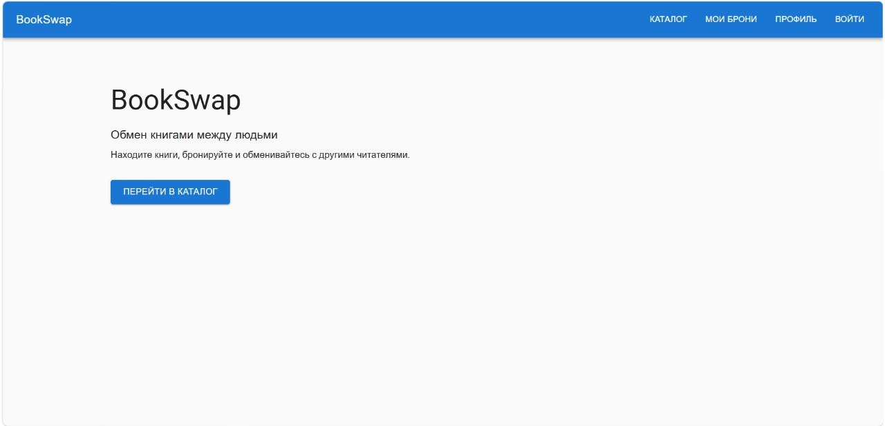

### Каталог
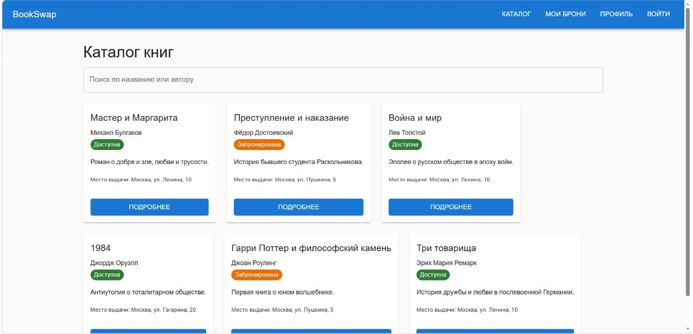

### Книга
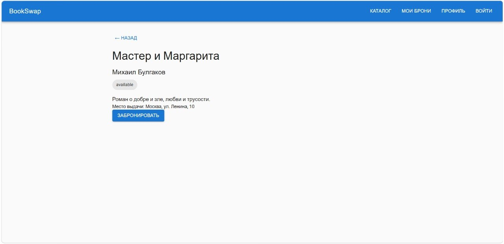

### Мои брони
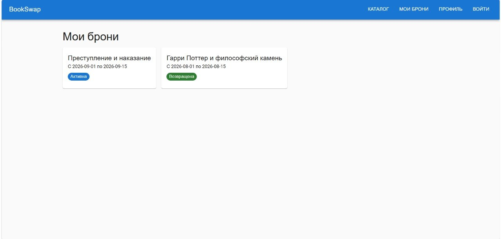

### Профиль
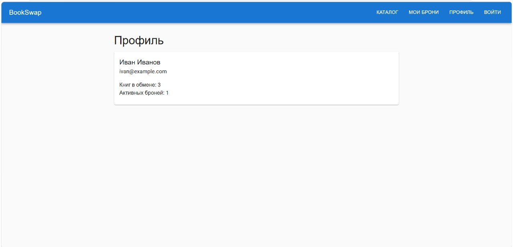

### Вход
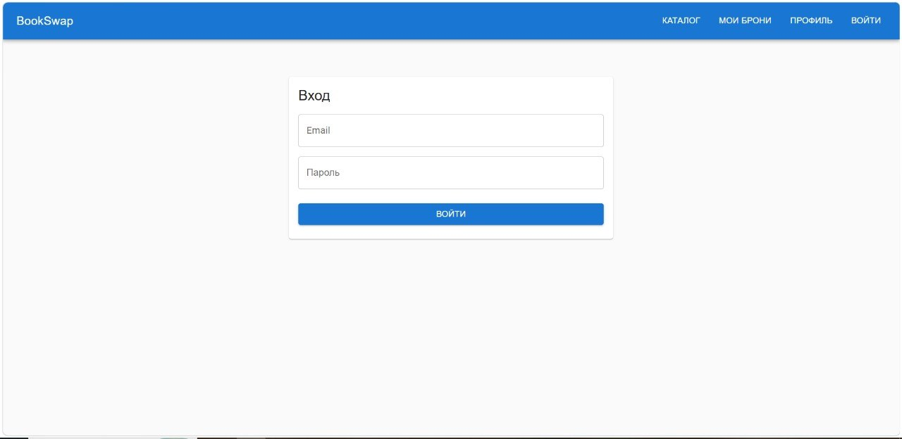

## Backend (ЛР №2)

### Стек
- Python 3.12 + FastAPI
- PostgreSQL + SQLAlchemy 2.0
- Alembic (миграции)
- Pydantic (валидация данных)

### Запуск backend

```bash
cd backend
python -m venv .venv
# Для Windows: .venv\Scripts\activate
pip install -r requirements.txt
docker compose up -d
alembic upgrade head
uvicorn src.main:app --reload
```
### Скриншоты Backend

**Swagger UI:**
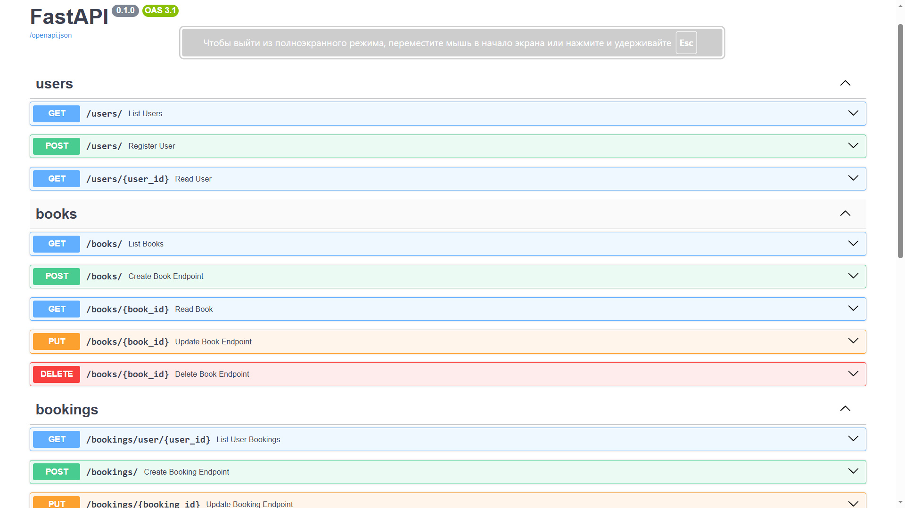 

**База данных (Adminer):**
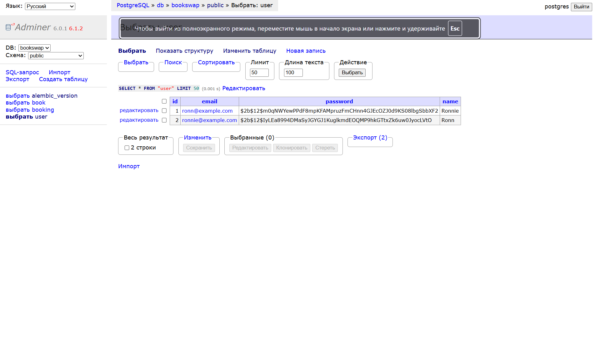

### ЛР №3: Интеграция frontend и backend
На данном этапе приложение полностью избавилось от демонстрационных данных (mock). Фронтенд связан с реальным API FastAPI.

### Что реализовано:
Axios-клиент: вынесен в shared/api/client.ts с базовым URL и перехватчиком ошибок.

Запросы к API: методы fetchBooks, fetchBookById, createBook вынесены в entities/book/api.ts.

Состояния загрузки: при запросе каталога отображается индикатор CircularProgress.

Обработка ошибок: при сбоях сети или ошибках сервера выводится компонент Alert.

Состояние пустых данных: если книг нет или поиск не дал результатов, выводится информационное сообщение.

Форма добавления книги: страница /books/new с клиентской валидацией обязательных полей (название, автор).

Бронирование: кнопка «Забронировать» на странице книги отправляет POST запрос и создает реальную запись в БД.

Защита от дублирования: на бэкенде добавлена проверка (в crud/bookings.py), которая запрещает бронировать одну и ту же книгу дважды.

Анимации: карточки книг в каталоге появляются с плавной анимацией (MUI Fade).

### Скриншоты Frontend (ЛР3)
**Каталог книг (реальные данные из БД):**
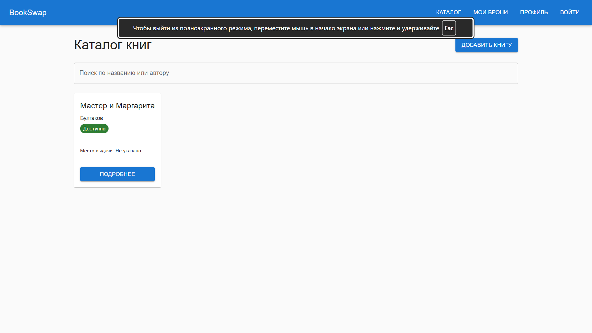

**Форма добавления книги:**
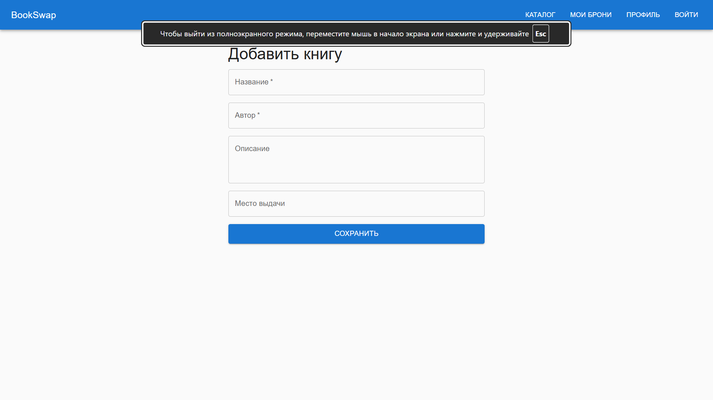

**Мои брони (список):**
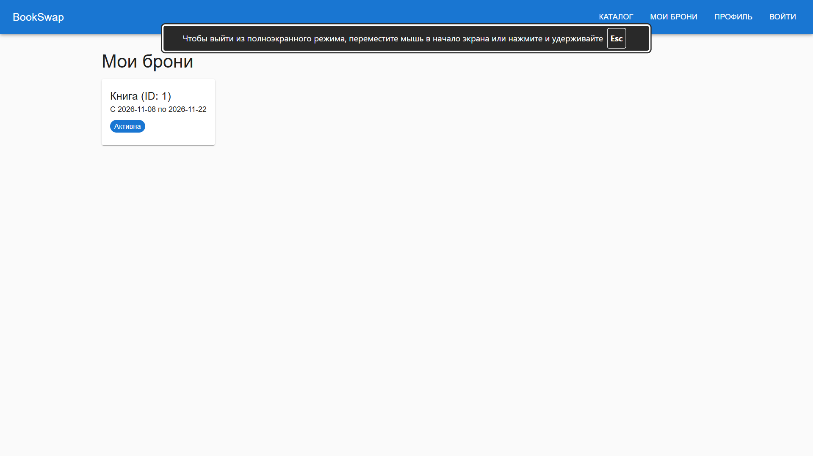

**Защита от дублирования броней (ошибка):**
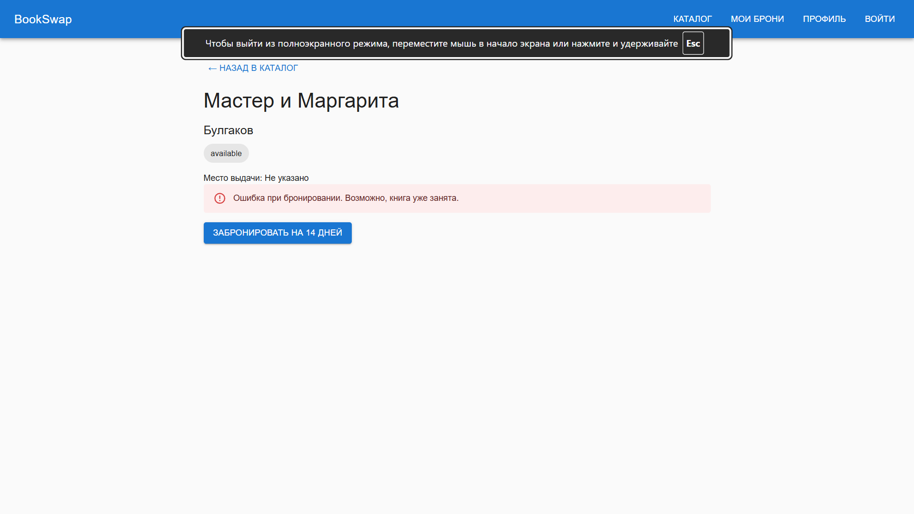