# BookSwap — обмен книгами

Веб-приложение для обмена книгами между пользователями.

## Назначение

Приложение позволяет:
- Просматривать каталог книг.
- Бронировать книги на время.
- Отслеживать сроки возврата.
- Указывать места выдачи.
- Смотреть простую статистику.

## Пользовательские сценарии

1. **Гость** — просмотр каталога, поиск, фильтры.
2. **Пользователь** — регистрация, вход, бронирование, просмотр своих броней.
3. **Владелец книги** — добавление книги, управление доступностью.

## Экраны

| Экран | Маршрут | Назначение |
|---|---|---|
| Главная | `/` | Приветствие, популярные книги |
| Каталог | `/catalog` | Список книг, поиск, фильтры |
| Книга | `/books/:id` | Детали книги, кнопка бронирования |
| Мои брони | `/my-bookings` | Список броней пользователя |
| Профиль | `/profile` | Данные пользователя |
| Вход | `/login` | Форма входа |

## Стек

- **Frontend:** React + TypeScript, Vite, React Router, MUI.
- **Backend:** (будет добавлен в ЛР №2) Python + FastAPI + PostgreSQL + SQLAlchemy.

## Структура frontend

- `app/` — настройка приложения (роутер, layout)
- `pages/` — страницы
- `entities/` — сущности (Book, Booking)
- `shared/` — общие компоненты и утилиты

## Запуск frontend

```bash
cd frontend
npm install
npm run dev
```

## Скриншоты

### Главная
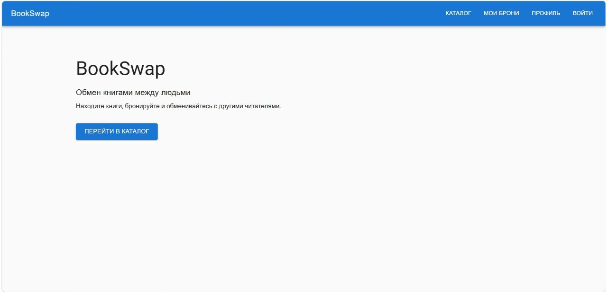

### Каталог
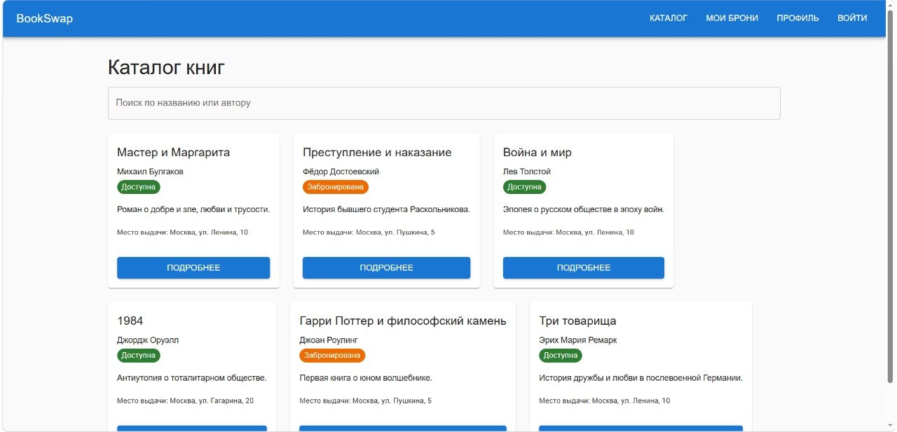

### Книга
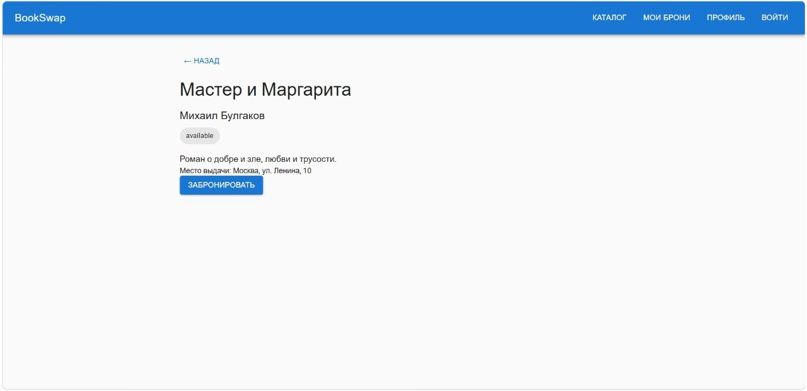

### Мои брони
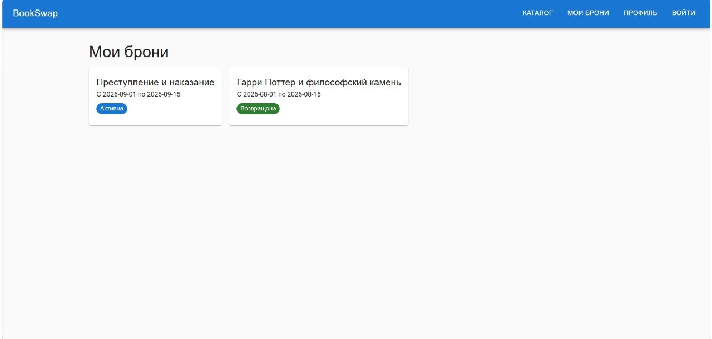

### Профиль
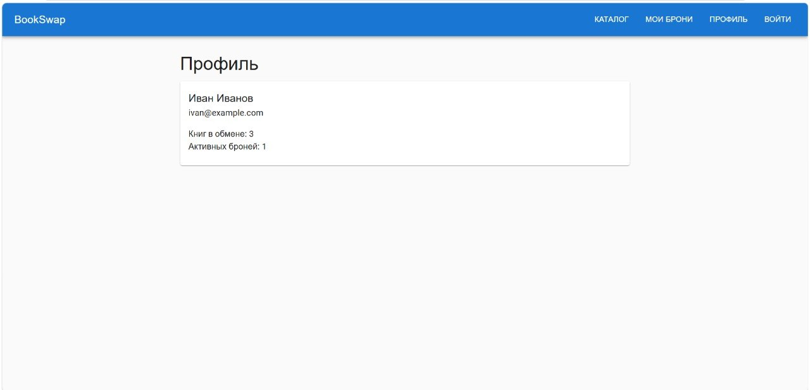

### Вход
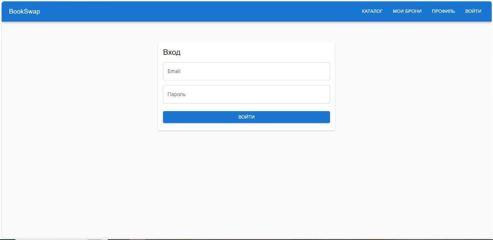

## Backend (ЛР №2)

### Стек
- Python 3.12 + FastAPI
- PostgreSQL + SQLAlchemy 2.0
- Alembic (миграции)
- Pydantic (валидация данных)

### Запуск backend

```bash
cd backend
python -m venv .venv
# Для Windows: .venv\Scripts\activate
pip install -r requirements.txt
docker compose up -d
alembic upgrade head
uvicorn src.main:app --reload
```
### Скриншоты Backend

**Swagger UI:**
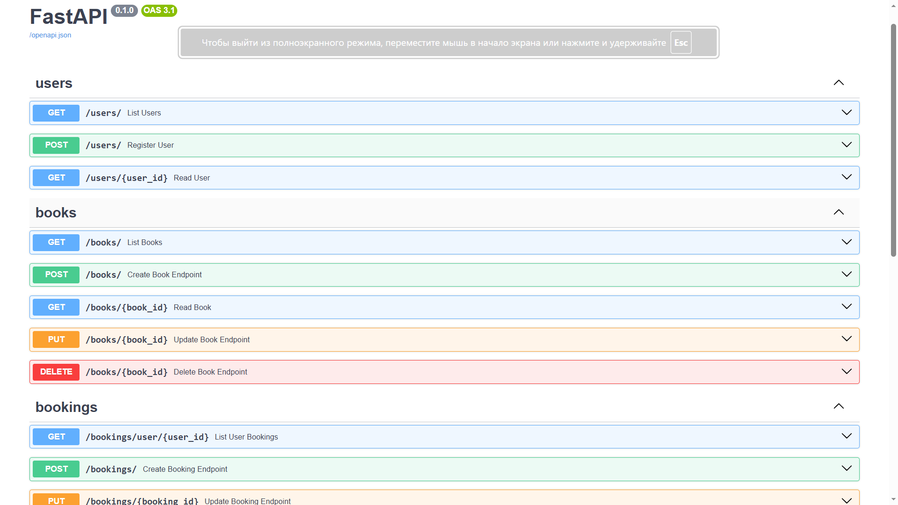 

**База данных (Adminer):**
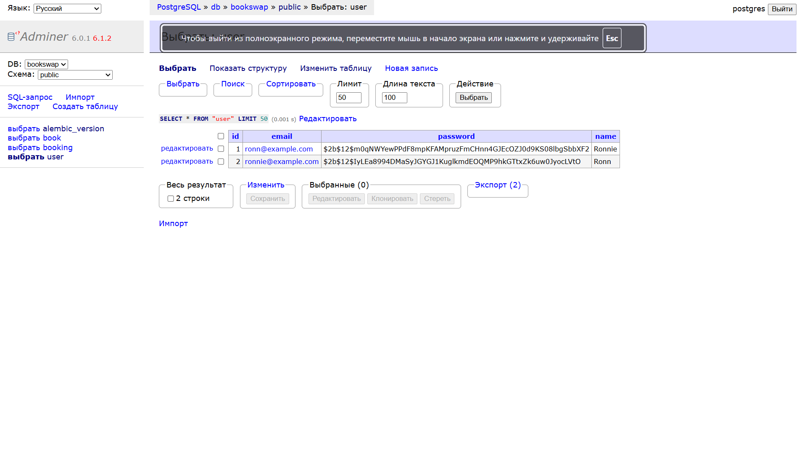

### ЛР №3: Архитектура frontend и динамический интерфейс
## Структура frontend

Проект организован по упрощённой методологии Feature-Sliced Design (FSD):
- `app/` — инициализация приложения, маршрутизация (`router.tsx`) и общий макет (`Layout`, `Header`)
- `pages/` — экраны приложения (`HomePage`, `CatalogPage`, `BookPage`, `AddBookPage`, `MyBookingsPage`, `ProfilePage`, `LoginPage`)
- `features/` — пользовательские действия и интерактивные формы (`book-search`, `add-book`, `reserve-book`, `auth-demo`)
- `entities/` — сущности предметной области, типы TypeScript и карточки отображения (`book`, `booking`)
- `shared/` — общие UI-компоненты, конфигурация клиента и демонстрационные данные (`mock`)

### Что реализовано:
- **Модульная структура с выделением слоя `features`:** логика поиска и фильтрации каталога, добавления книги, бронирования и входа вынесена из страниц в отдельные модули `features/*`.
- **Типизация TypeScript:** описаны интерфейсы сущностей (`Book`, `Booking`), типы статусов и свойства (`props`) всех компонентов.
- **Клиентская валидация форм:** реализована проверка обязательных полей, минимальной длины и корректности диапазона дат бронирования с выводом понятных сообщений об ошибках под полями.
- **Состояния экранов данных:** для каталога, страницы книги, списка броней и профиля реализованы состояния загрузки (`CircularProgress`), ошибки (`Alert` с возможностью повтора) и отсутствия данных (`empty state`).
- **Анимации и переходы:** использованы переходы MUI (`Fade`, `Collapse`) при появлении карточек книг, броней, форм и уведомлений.

### Скриншоты Frontend (ЛР3)
**Главная:**
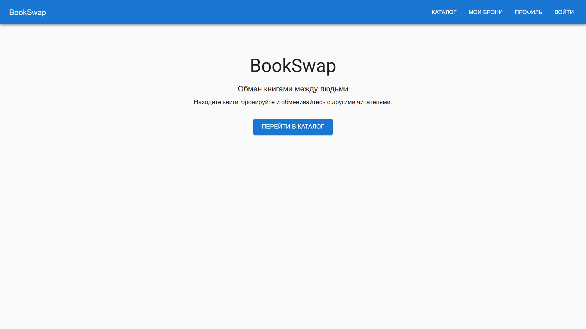

**Каталог книг:**
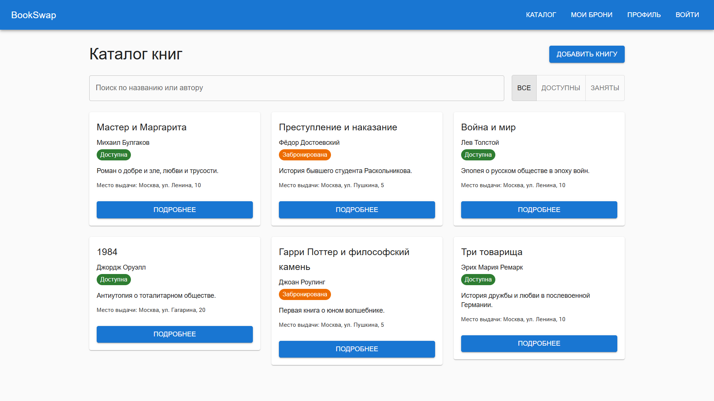
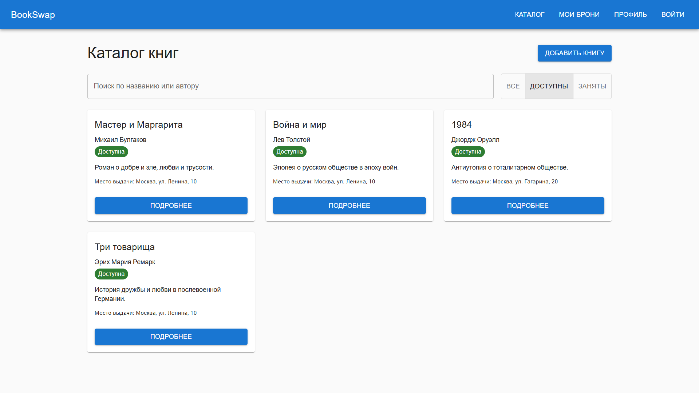
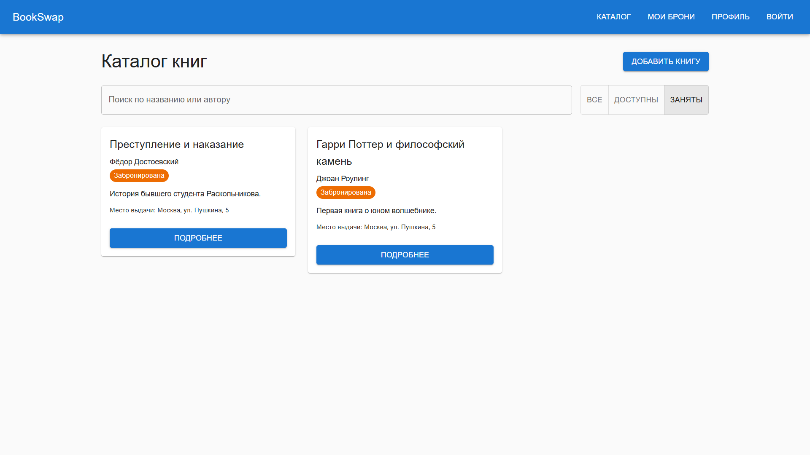

**Мои брони:**
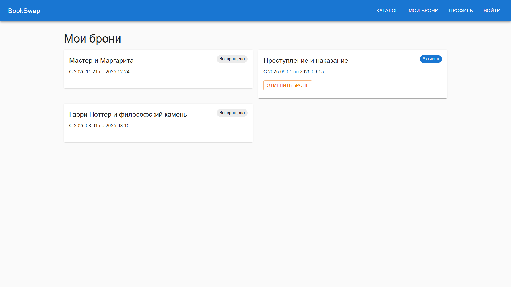

**Вход:**
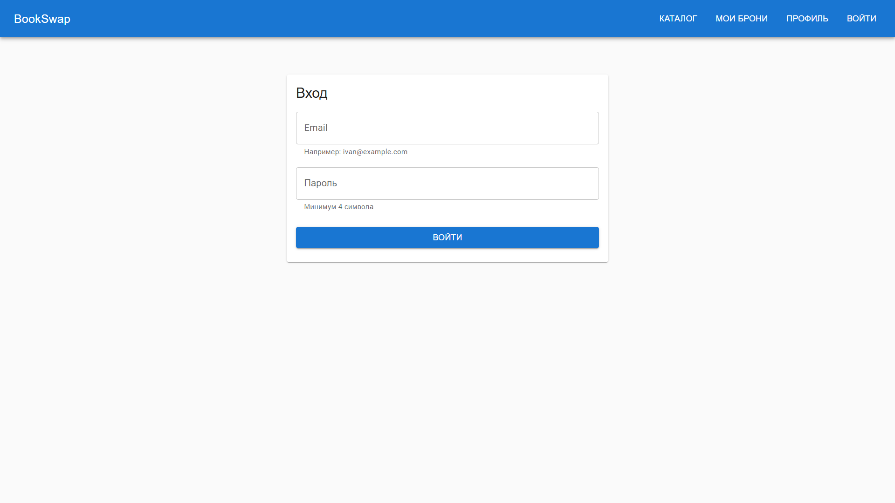
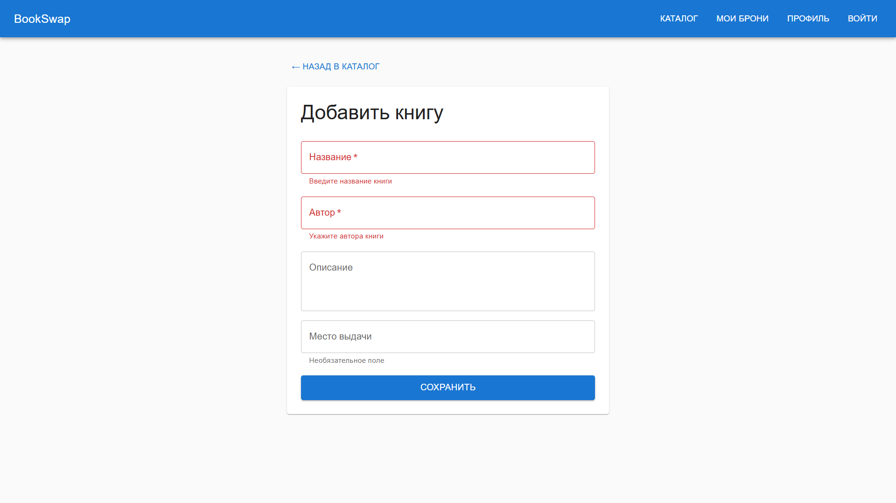